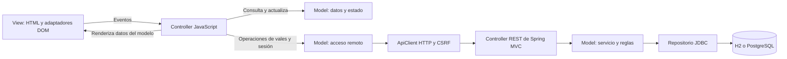

# Arquitectura MVC

La aplicación organiza el caso B con **Model–View–Controller**. Spring MVC recibe las peticiones HTTP y el navegador utiliza controladores JavaScript para coordinar las interacciones de atención y login.

## Flujo



La vista captura eventos y muestra datos. El controlador decide qué acción ejecutar, coordina las operaciones del modelo y ordena renderizar. El modelo conserva los datos, reglas y estado. La base de datos y la validación definitiva permanecen en el servidor.

## Backend Java

```text
src/main/java/pe/vales/
├── ValesApplication.java
├── controller/
│   ├── ValeController.java         # Peticiones HTTP /api y respuestas JSON
│   └── ApiErrors.java              # Traducción de errores a respuestas HTTP
├── model/
│   ├── Vale.java                   # Datos de un vale y su atención
│   ├── PaginaVales.java            # Resultado paginado
│   └── dto/AtencionRequest.java    # Datos permitidos y validación de entrada
├── domain/
│   ├── ConsumoPolicy.java          # Reglas e importe calculado con BigDecimal
│   └── ReglaException.java
├── service/AtencionService.java    # Caso de uso y transacción de atención
├── persistence/ValeRepository.java # SQL parametrizado y bloqueos de filas
└── config/                        # Seguridad, reloj y datos de demostración
```

`ValeController` es un controlador de Spring MVC anotado con `@RestController`. Recibe JSON, valida los datos y delega las escrituras a `AtencionService`. Las consultas se resuelven mediante el repositorio. Los modelos de respuesta están en `model/` y el DTO de entrada en `model/dto/`.

El Model del backend incluye los datos y las capas que implementan su comportamiento: dominio, servicio y persistencia. Se conserva el cálculo definitivo del importe, los bloqueos `SELECT ... FOR UPDATE`, el aislamiento por proveedor y el rollback del lote.

## Frontend

```text
src/main/resources/static/
├── index.html
├── login.html
├── style.css
└── js/
    ├── models/
    │   ├── atencion-model.js       # Estado, selección, borradores y cálculo previo
    │   ├── login-model.js          # Estado del login, sin contraseña almacenada
    │   ├── vale-model.js           # Contrato de datos con la API y reglas de formulario
    │   └── session-model.js        # Operaciones de sesión
    ├── controllers/
    │   ├── atencion-controller.js  # Coordina acciones, peticiones y renderizado
    │   └── login-controller.js     # Coordina autenticación y actualiza la vista
    ├── views/
    │   ├── atencion-view.js        # Renderizado y captura de eventos
    │   ├── login-view.js
    │   └── formatters.js           # Formatos y escape HTML
    ├── core/api-client.js          # Transporte HTTP y CSRF
    ├── app.js                     # Composición de atención
    └── login.js                   # Composición de login
```

### Model

`AtencionModel` mantiene los filtros, datos consultados, selección, detalle, borradores, estados de carga/guardado y mensajes. Sus métodos gestionan la selección, validan el formulario, construyen el payload permitido y aplican los resultados. `snapshot()` devuelve los datos que necesita la vista, incluyendo totales, paginación y elegibilidad de controles.

`LoginModel` conserva únicamente estado de carga, error y destino. La contraseña pasa como argumento a la operación de sesión y no se almacena en ese modelo.

`ValeModel` y `SessionModel` adaptan las operaciones de la API existente. `ApiClient` mantiene cookies de sesión, token CSRF y mensajes de error. Los modelos no acceden al DOM ni conocen una vista.

### View

`AtencionView` y `LoginView` exponen dos operaciones:

- `bind(actions)`: conecta eventos HTML con callbacks que proporciona el controlador.
- `render(data)`: presenta los datos recibidos y actualiza controles y diálogos.

Las vistas son pasivas: no consultan modelos ni se suscriben a cambios de estado. Tampoco llaman a `fetch`. El renderizado conserva los campos del formulario para no perder el foco mientras se escribe, y escapa los valores incorporados al HTML.

### Controller

`AtencionController` recibe los modelos y la vista por constructor. Conecta las acciones, ejecuta las consultas, decide qué actualizar y llama explícitamente a `view.render(stateModel.snapshot())`. El controlador conserva los identificadores de solicitudes para ignorar respuestas tardías.

Cuando el usuario edita una cantidad, la vista envía el evento al controlador; este modifica el borrador mediante el modelo y vuelve a renderizar. Cuando confirma un consumo, el controlador valida mediante el modelo, envía el payload y aplica el resultado antes de actualizar la vista.

`LoginController` recibe la acción de ingreso, coordina `SessionModel` y actualiza la vista con el estado de `LoginModel`. Los controladores no manipulan HTML ni realizan consultas SQL.

Los puntos de entrada solo construyen las dependencias. Las clases se agrupan en `globalThis.Vales` y los HTML cargan scripts `defer` en orden. No se necesita un framework JavaScript ni un proceso frontend adicional.

## Contrato, datos y seguridad

Se mantienen las rutas de la API, el JSON, los estados y el esquema de la base de datos. La atención continúa siendo única por vale; el precio real se ingresa manualmente y Java verifica cantidad, precio e importe. H2 y PostgreSQL conservan su configuración anterior.

El login puede cargar los scripts públicos `/js/**`. Las rutas de datos requieren sesión y rol GRIFO; las escrituras requieren CSRF. La reorganización no necesita borrar la base H2 ni ejecutar migraciones.

## Pruebas

En Linux con Python 3 y JavaScriptCore GTK:

```bash
python3 scripts/verificar-frontend.py
```

Con Node.js, como alternativa opcional sin instalar paquetes:

```bash
node scripts/test-frontend.cjs
```

La suite `scripts/tests/frontend-mvc.spec.js` contiene 27 pruebas. Utiliza los modelos y controladores reales, una vista espía y respuestas de datos simuladas. Comprueba que el controlador enlace eventos y renderice la vista, que el modelo funcione sin vista ni suscripciones, y los casos de consumo, selección, errores, concurrencia de solicitudes, sesión y CSRF.

El verificador también revisa sintaxis, referencias a archivos, selectores y límites entre capas. Las pruebas HTTP/JDBC se ejecutan con `./gradlew test bootJar` o `.\gradlew.bat test bootJar` en Windows. La revisión completa en navegador es adicional; consulta [VERIFICACION.md](VERIFICACION.md).

## Actualización local

Quienes clonaron el repositorio pueden obtener los cambios con `git pull --ff-only` en su copia. Detén cualquier ejecución anterior y vuelve a iniciar `./gradlew clean bootRun`; en Windows, `.\gradlew.bat clean bootRun`. Recarga el navegador con Ctrl+F5 para cargar los scripts nuevos. Conserva la carpeta `data` para mantener los consumos locales.

El comando `clean` elimina los resultados compilados de los paquetes anteriores y vuelve a copiar los assets actuales; no elimina la carpeta `data`.
