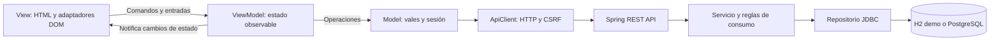

# Arquitectura MVVM

La aplicación aplica **Model–View–ViewModel** a la presentación web, incluyendo la atención de vales y el inicio de sesión. La separación permite probar las acciones y el estado de la interfaz sin navegador, sin servidor y sin base de datos.

## Flujo de datos



MVVM organiza la presentación. Spring Boot sigue exponiendo una API REST con servicios y repositorios como backend del modelo. Los controladores Java reciben HTTP; los ViewModels JavaScript mantienen el estado de la pantalla. No se equipara un controlador REST con un ViewModel ni se trasladan las decisiones de persistencia al navegador.

## Estructura

```text
src/main/resources/static/
├── index.html                         # Vista de atención
├── login.html                         # Vista de login
├── style.css
└── js/
    ├── core/
    │   ├── observable-view-model.js  # Suscripción y publicación de estado
    │   └── api-client.js             # HTTP, cookies de sesión, CSRF y errores
    ├── models/
    │   ├── vale-model.js             # Contrato de vales y reglas de presentación
    │   └── session-model.js          # Sesión, login y logout
    ├── viewmodels/
    │   ├── atencion-view-model.js    # Filtros, selección, borradores y comandos
    │   └── login-view-model.js       # Estado de autenticación de la pantalla
    ├── views/
    │   ├── atencion-view.js          # Adaptador DOM de atención
    │   ├── login-view.js             # Adaptador DOM del login
    │   └── formatters.js             # Moneda, cantidades, fechas y escape HTML
    ├── app.js                        # Composición de atención
    └── login.js                      # Composición del login
```

Las clases se agrupan bajo el espacio de nombres `globalThis.Vales`. Los HTML cargan sus scripts con `defer` en orden de dependencias. No se requiere un empaquetador ni instalar bibliotecas JavaScript. Los scripts estáticos pueden cargarse antes de iniciar sesión; la API conserva su protección mediante Spring Security.

## Model

`ValeModel` concentra las operaciones `list`, `detail`, `summary`, `zones` y `attend`, utilizando el contrato `/api` existente. `SessionModel` concentra la sesión y su autenticación. Ambos reciben `ApiClient` por constructor.

`ValeRules` reúne la elegibilidad de presentación y la validación de borradores. El cálculo previo usa enteros `BigInt` para mantener el redondeo HALF_UP sin errores de punto flotante.

`ApiClient` se ocupa del transporte: cookies del mismo origen, token CSRF y errores HTTP. El login renueva el token después de autenticar. Los modelos no manipulan elementos HTML ni navegan entre páginas.

## ViewModel

`ObservableViewModel` permite `subscribe(listener)` y devuelve una función para cancelar la suscripción. Cada cambio publica el nuevo estado. La View se conecta una vez y se actualiza al recibir esas notificaciones.

`AtencionViewModel` mantiene filtros, página, filas, selección, detalle, borradores, total de vista previa, errores y estados de carga/guardado. Expone comandos como `search`, `changeState`, `select`, `reviewSelected`, `editDraft`, `save` y `logout`.

Los borradores viven en el ViewModel, incluidos los valores que todavía no se guardaron. Un error conserva esos datos y la selección. Mientras se guarda, se bloquean otra confirmación, la edición y el cierre del diálogo. Las respuestas tardías de búsquedas o detalles no reemplazan el estado más reciente.

`LoginViewModel` maneja carga, errores y destino de navegación. La contraseña se pasa al modelo durante la operación; no se almacena en el estado observable.

Los ViewModels no utilizan `document`, `window`, `location`, HTML ni `fetch`. Reciben los modelos por constructor, por lo que las pruebas pueden sustituir únicamente la frontera de datos.

## View

Los HTML y sus adaptadores `AtencionView`/`LoginView` son responsables de mostrar datos, actualizar controles, abrir/cerrar diálogos y capturar eventos.

El enlace es explícito: un evento de entrada llama a `editDraft`, y la suscripción vuelve a mostrar el total del estado. La View no calcula consumos ni construye peticiones HTTP. Los adaptadores conservan los inputs al actualizar el estado para evitar perder foco o texto mientras se escribe. `Formatters` escapa los valores antes de insertarlos en HTML.

Los puntos de entrada solo construyen `ApiClient → Model → ViewModel → View` y ponen en marcha la carga inicial.

## Backend y base de datos

El backend mantiene `ValeController`, `AtencionService`, `ConsumoPolicy` y `ValeRepository`. La validación definitiva, el cálculo del importe con `BigDecimal`, el bloqueo `FOR UPDATE` y la transacción atómica permanecen en Java. Las reglas del cliente ayudan a completar el formulario; el servidor vuelve a validar cada consumo.

El cambio conserva las rutas JSON, los estados del vale y el esquema. La demo sigue usando H2 y el perfil `postgres` usa la base administrativa. No se necesita migrar ni borrar la base H2 existente. El único ajuste de seguridad de esta reorganización permite cargar `/js/**` antes de autenticar, para servir el login; las rutas de datos siguen exigiendo sesión y rol GRIFO.

## Comprobar la arquitectura

En Linux con Python 3 y JavaScriptCore GTK:

```bash
python3 scripts/verificar-frontend.py
```

El verificador revisa sintaxis de scripts, referencias a assets y límites entre capas; ejecuta las 25 pruebas de `scripts/tests/frontend-mvvm.spec.js`. Como alternativa opcional, con Node.js:

```bash
node scripts/test-frontend.cjs
```

Las pruebas cubren inicialización, filtros, carreras de búsqueda, selección entre estados, límite de lote, borradores y totales, validaciones, doble clic, éxito/fallo, conservación de datos, sesión, CSRF y login. Usan las clases reales del modelo y del ViewModel, con respuestas simuladas de sus dependencias; no requieren el DOM ni una base de datos.

Para verificar el backend y generar el JAR sigue disponible `./gradlew test bootJar` (Windows: `.\gradlew.bat test bootJar`). La revisión completa de interacción en navegador es una comprobación adicional.

## Mantener la separación

- Cambios visuales y eventos HTML: `views/` y plantillas HTML.
- Nuevos estados o acciones de pantalla: `viewmodels/`.
- Nuevas operaciones de datos: `models/` y el contrato REST.
- Reglas definitivas de negocio o persistencia: backend Java.
- No realizar peticiones HTTP desde una View ni acceder al DOM desde un ViewModel.
